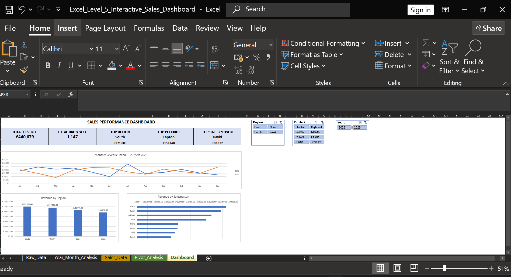

# 01 — Excel

This section contains the Excel part of the Data Analysis Course.

We will start from the fundamentals and progress toward professional data-analysis workflows.

## Excel Learning Progress

### ✅ Level 1 — Excel Foundations — COMPLETE

**Topics completed:**
- Excel workbook and worksheet fundamentals
- Rows, columns, cells, and ranges
- Working with structured datasets
- Understanding text and numerical data
- Basic data exploration
- SUM
- AVERAGE
- MIN
- MAX
- COUNT
- COUNTA
- Basic sorting and filtering
- Identifying patterns and trends in data
- Basic business-data interpretation

---

### ✅ Level 2 — Formulas & Logical Analysis — COMPLETE

**Topics completed:**
- COUNTIF
- COUNTIFS
- SUMIF
- SUMIFS
- AVERAGEIF
- AVERAGEIFS
- IF
- Nested IF
- IFS
- AND
- OR
- NOT
- IFERROR
- Conditional calculations
- Multiple-criteria analysis
- Practical formula-based business analysis

---

### ✅ Level 3 — Data Cleaning — COMPLETE

**Topics completed:**
- Identifying data-quality problems
- Removing duplicate records
- Handling inconsistent text
- TRIM
- PROPER
- LOWER
- LEFT
- MID
- LEN
- FIND
- Find & Replace
- Remove Duplicates
- Cleaning and standardising datasets
- Validating cleaned data
- Professional dataset formatting
- Practical data-cleaning project

---

### ✅ Level 4 — Lookups & Pivot Tables — COMPLETE

**Lookup topics completed:**
- XLOOKUP
- VLOOKUP
- HLOOKUP
- Exact-match lookups
- Approximate-match lookups
- Absolute references in lookup formulas
- Custom not-found messages
- IFERROR with lookup functions
- Retrieving values from structured datasets

**Pivot Table topics completed:**
- Creating Pivot Tables
- Rows, Columns, Values, and Filters
- Sum and Count calculations
- Sorting and filtering Pivot Tables
- Show Values As
- % of Grand Total
- Excel Tables as dynamic Pivot Table sources
- Refreshing Pivot Tables
- Date grouping
- Grouping by Months
- Grouping by Quarters
- Grouping by Years
- Multi-level date analysis
- Pivot Charts
- Column charts
- Line charts
- Chart titles and data labels
- Currency and percentage formatting
- Chart filtering and field buttons
- Choosing appropriate charts for business questions
- Business insight interpretation
- Independent Pivot Table Practical Challenge

---

## Current Progress

| Level | Topic | Status |
|---|---|---|
| Level 1 | Excel Foundations | ✅ Complete |
| Level 2 | Formulas & Logical Analysis | ✅ Complete |
| Level 3 | Data Cleaning | ✅ Complete |
| Level 4 | Lookups & Pivot Tables | ✅ Complete |
| Level 5 | Excel Dashboards & Visual Reporting | ✅ Complete |

## Projects

### Excel Level 3 Final Project
A practical Excel project demonstrating the skills developed during Level 3 of the course.

### Excel Pivot Table Practical Challenge
An independent business analysis project using Pivot Tables and Pivot Charts to analyse sales performance.

**Skills demonstrated:**
- Excel Tables and dynamic data sources
- Pivot Tables
- Sorting and filtering
- Date grouping by month
- Sum of Revenue analysis
- Percentage of Grand Total
- Pivot Charts
- Currency and percentage formatting
- Business data interpretation

**Key findings:**
- East was the highest-performing region, generating £12,700 and contributing 30.53% of total revenue.
- Michael was the highest-performing salesperson, generating £12,700 in total revenue.
- Laptops generated the highest product revenue at £27,600.
- Monthly revenue fluctuated from January to August, with August recording the highest monthly revenue at £8,300.
- Total revenue analysed was £41,600.

**Workbook:** `Excel_Pivot_Table_Practical_Challenge.xlsx`

### Excel Level 4 — Lookups & Pivot Tables

This workbook demonstrates the use of Excel lookup functions and Pivot Tables for practical data analysis.

**Skills demonstrated:**
- XLOOKUP
- VLOOKUP
- HLOOKUP
- Exact-match lookups
- Retrieving data from structured datasets
- Excel Tables and dynamic data sources
- Pivot Tables
- Sorting and filtering Pivot Tables
- Show Values As calculations
- Date grouping by months, quarters, and years
- Pivot Charts
- Business data interpretation

**Workbook:** `Excel_Level_4_Lookups_Pivot_Tables.xlsx`

---

### Excel Level 5 — Interactive Sales Dashboard

Built an interactive Excel sales performance dashboard to analyse revenue, units sold, regional performance, product performance, salesperson performance, and monthly sales trends across 2025 and 2026.

#### Dashboard Preview

**Skills demonstrated:**
- Data validation and quality checks
- Excel Tables and structured data
- Pivot Tables
- Pivot Charts
- KPI cards
- Revenue and units-sold analysis
- Regional performance analysis
- Product performance analysis
- Salesperson performance analysis
- Monthly and yearly trend analysis
- Interactive slicers
- Report Connections across multiple Pivot Tables
- Multi-filter dashboard analysis
- Dashboard layout and visual formatting
- Dashboard testing and quality assurance

**Dashboard KPIs:**
- Total Revenue: £440,679
- Total Units Sold: 1,147
- Top Region: South — £121,083
- Top Product: Laptop — £152,640
- Top Salesperson: David — £83,122

**Dashboard visuals:**
- Monthly Revenue Trend — 2025 vs 2026
- Revenue by Region
- Revenue by Salesperson

**Interactive filters:**
- Region
- Product
- Year

The slicers are connected across multiple Pivot Tables, allowing users to dynamically analyse combinations of region, product, and year.

**Key analytical insight:**

Filtering the dashboard to South and 2026 showed total revenue of £37,962 from 156 units. Printer was the top-performing product for this selection, generating £21,398 from 48 units.

**Workbook:** `Excel_Level_5_Interactive_Sales_Dashboard.xlsx`

**Dashboard Preview:** `Level_5_Sales_Dashboard_Preview.png`
